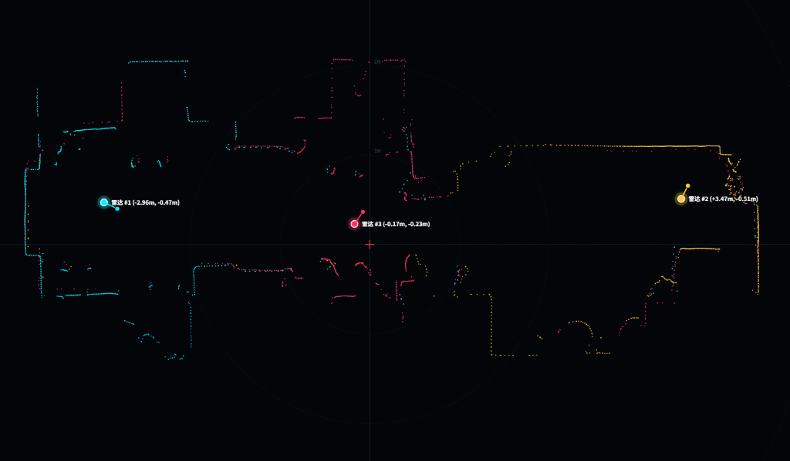

# STL-06N / LD19 多激光雷达空间标定与点云融合工作台
### (Web-based Multi-LiDAR Calibration & Point Cloud Fusion Workbench)

> **基于 Web Serial API 与 HTML5 Canvas 构建的纯前端、免安装、多激光雷达空间拼接标定与实时可视化工具。**  
> 无需配置 ROS、Python 环境或安装重量级客户端，在现代浏览器（Chrome / Edge）中即可直接驱动多台串口激光雷达，实现厘米级交互式对齐与大场景点云拼接。

---

## 📸 拼接效果展示 (Multi-LiDAR Fusion Result)



> **图示说明**：上图为 3 台物理激光雷达（雷达 #1 青色、雷达 #3 品红、雷达 #2 琥珀金）在室内大空间进行空间拼接融合的真实点云图。各雷达重叠区域的直线墙体、门垛与立柱点云轮廓完美严密贴合。

---

## 🌟 核心功能特性

### 1. 纯前端零依赖，即开即用
- 深度基于浏览器原生 **Web Serial API**，无需本地编译 C++、搭建 ROS 环境或配置 Python 虚拟环境。
- 打开 HTML 网页即可直接枚举并连接多个 USB-TTL 串口（默认 230400 bps）。

### 2. 独立色彩通道与多机实时融合
- 支持同时接入 3 台或更多激光雷达，各雷达拥有专属荧光色彩通道（如 `#00f2fe` 蓝、`#ff007f` 红、`#00ff87` 绿等）。
- 点云采用高效角度桶聚类（720 桶 / 0.5° 分辨率）与时间戳生命周期管理，高帧率动态刷新，无拖尾残影。

### 3. 厘米级 (0.01m) 鼠标直接拖拽标定
- **画布直拖**：直接用鼠标按住画布中的雷达原点圆圈即可在世界坐标系内随意拖拽移动。
- **步进微调**：默认支持 **0.01m (1cm)** 高精度网格对齐；按住 **Shift 键** 更可激活 **0.001m (1mm)** 极限微调。
- **辅助参考线**：拖拽时动态投射与世界原点及 X/Y 轴的虚线对齐投影，空间定位清晰准确。

### 4. 视角优先的镜像翻转算法 (Orientation-First Mirroring)
- **解决痛点**：传统镜像算法在雷达带有安装旋转角时翻转会导致已调平的墙线严重倾斜。
- **创新变换流程**：
  $$\text{局部极坐标} \xrightarrow{\text{方向反转}} \text{极坐标转笛卡尔} \xrightarrow{\text{安装角旋转}} \text{当前屏幕坐标系} \xrightarrow{\text{水平/垂直正反镜像}} \xrightarrow{\text{世界平移}}$$
  **实测极佳操作流**：先旋转安装角使墙线在屏幕上水平或竖直，再切换水平/垂直翻转，墙体角度绝不打偏！

### 5. 点云导出、导入与离线标定
- **导出 Fused CSV**：一键将多台雷达融合后的全部点云输出为标准 CSV 文件（字段：`radar_id, world_x_m, world_y_m, intensity`）。
- **导入历史 CSV**：支持离线加载之前采集的点云文件，随时离场复现现场空间结构并继续进行标定与微调。
- **高清快照**：支持一键将当前对齐视图导出为透明背景 PNG 图像，便于汇报与布场图纸存档。

---

## 🧭 推荐空间标定操作流程

```
[连接串口] ➔ [1. 扫描方向反转] ➔ [2. 安装角旋转调平] ➔ [3. 水平/垂直镜像] ➔ [4. 鼠标直接拖拽对齐]
```

1. **扫描方向 (Direction)**：若雷达倒装或扫描逆时针，勾选 **扫描方向反转 (Invert)**。
2. **调平旋转 (Rotation)**：旋转右侧面板的 **安装偏角 (Angle)** 滑块（0.5° 步长），将探测到的特征墙面对齐到横平竖直。
3. **镜像校验 (Mirror)**：若左右或上下空间方向与实际场地相反，勾选 **水平翻转 (X)** 或 **垂直翻转 (Y)**。
4. **平移拼合 (Translation)**：在左侧画布上，直接鼠标点击雷达圆心拖动，使该雷达的墙线与基准雷达（如 3 号雷达）的特征线完全重叠吸收。

---

## 📂 项目结构说明

```text
STL06N-MultiLiDAR-Workbench/
├── assets/
│   └── fusion_preview.png                     # 多雷达拼接点云效果实测示意图
├── STL06N_MultiLiDAR_Workbench.html           # 【核心】多雷达空间标定与点云融合主工作台
├── STL06N_LiDAR_Tester.html                   # 单雷达极坐标诊断与串口吞吐测试工具
├── LD19_Radar_Viewer.py                       # 备用 Python 原生解析与图形监视器脚本
├── 双击启动雷达监视器.bat                      # Windows 一键启动 Python 监视脚本
├── 一键修复串口鼠标乱飞.reg                     # Windows 注册表禁用串口即插即用鼠标枚举
├── 一键修复鼠标乱飞(右键以管理员身份运行).bat    # 彻底解决插入串口后光标疯狂乱跳问题
├── CP2102_Driver/                             # Silicon Labs CP2102 官方 USB-TTL 驱动安装包
├── .gitignore                                 # Git 忽略文件配置
└── README.md                                  # 项目技术文档与使用手册
```

---

## ⚡ 常见问题排查与解决

### Q1: 插入串口后 Windows 鼠标指针乱飞、疯狂点击？
- **原因**：Windows 系统服务误将高频雷达数据流识别为了古老的 **Microsoft Serial BallPoint** 串口鼠标。
- **解决**：在项目中右键以管理员身份运行 `一键修复鼠标乱飞(右键以管理员身份运行).bat`，重启电脑后即可永久修复。

### Q2: 浏览器点击连接没有弹出串口选择框？
- 请确保使用 **Google Chrome (>=89)**、**Microsoft Edge (>=89)** 或支持 Web Serial API 的 Chromium 内核浏览器。
- 若通过非 `localhost` 访问，Web Serial 要求运行在 `HTTPS` 安全协议下（直接双击本地 HTML 文件或 `file:///` 协议完全支持）。

### Q3: 设备管理器提示黄色感叹号驱动缺失？
- 进入 `CP2102_Driver` 目录，根据系统架构双击运行 `pololu-cp2102-setup-x64.exe` 或 `x86` 进行安装。

---

## 📡 硬件通信协议 (STL-06N / LD19)

- **波特率**：`230400 bps`（8 数据位，1 停止位，无校验）
- **数据帧格式**：
  - 帧头：`0x54`
  - 帧长度：`0x2C`（固定单包 12 个采样测距点）
  - 转速：2 字节无符号整数（度/秒）
  - 起始角度：2 字节（`0.01°` 精度）
  - 测距点数据：12 组（每组包含 2 字节距离值以 mm 为单位，1 字节反射信号强度）
  - 结束角度：2 字节（`0.01°` 精度）
  - 时间戳：2 字节
  - 校验码：CRC8 校验（多项式 `0x4D`）

---

## 📜 许可证 (License)

本项目基于 **MIT License** 开源，欢迎自由用于商业多媒体互动展览、数字展厅、空间交互装置以及机器人多激光雷达融合标定等各类工程项目。
